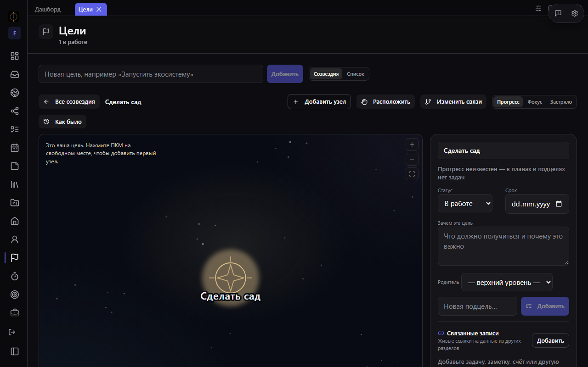
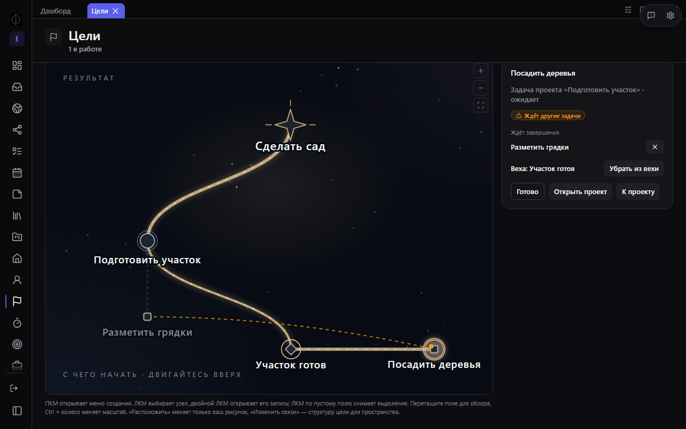
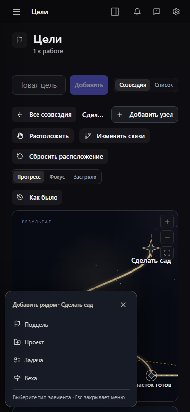

# Созвездие как рабочий канвас цели

Статус: рабочий UI-срез от 26.10.2026. Фактическая приёмка привязана к текущему checkout; релизный установщик этим документом не подтверждается. Архитектурные границы — [AGENTS.md](../AGENTS.md), [PLATFORM.md](PLATFORM.md); общее поведение созвездий — [GOALS_CONSTELLATIONS.md](GOALS_CONSTELLATIONS.md).

## Сценарий

1. Пользователь создаёт цель в разделе «Цели». Её созвездие открывается сразу, даже когда ещё нет проектов и подцелей. Корневая звезда показывает результат, свободное поле приглашает добавить первый шаг.
2. ПКМ по пустому месту открывает контекстное меню создания у точки нажатия. ПКМ по узлу открывает меню с ним в качестве контекста: можно создать элемент рядом, открыть исходную запись или начать связь от этого узла (когда тип поддерживает связи). Кнопка «Добавить узел» остаётся доступной для клавиатуры и сенсорного экрана. Можно создать подцель, проект, задачу, веху либо добавить существующий проект.
3. ЛКМ выбирает узел и показывает его действия в инспекторе. ЛКМ по пустому полю снимает выделение и закрывает меню; перетаскивание пустого поля перемещает вид карты. Двойной ЛКМ по узлу открывает исходную запись. Меню закрывается по Esc или нажатию вне его.
4. Создание пишет в исходные модули. Подцель — `Goal.parentId`, проект — реальный `Project` плюс план `GoalPlan`, задача — `Task.projectId`, веха — `Milestone.projectId`. Если для задачи или вехи ещё нет проекта, его создание и привязка явно показаны в редакторе. После успеха узел появляется на карте и становится выбранным. Лишний success-toast не перекрывает канвас.
5. Процент цели по-прежнему считается по задачам проектов и подцелям на сервере. Веха без задач не создаёт фиктивный прогресс. Расположение узла хранится локально в браузере, общая структура — в API.
6. В режиме «Изменить связи» пользователь выбирает исходный узел, нажимает «Связать от этого узла» и выбирает второй. Задача → задача означает зависимость второй от первой. Веха → веха того же проекта означает зависимость второй вехи. Задача → веха включает задачу в этап. Подцель → цель меняет родителя. Пунктирная линия со стрелкой отделяет зависимость от основной ветви цели. Зависимости задач и вех можно убрать в инспекторе; задачу можно вынуть из вехи. Остальные операции остаются доступны через уже существующие элементы инспектора.

## Границы

- Случайные перетаскивания поля меняют только вид карты. Структуру данных меняет явный режим связей. Сервер повторно проверяет права и циклы.
- Задача и веха обязаны принадлежать проекту: канвас не создаёт дублирующие «карточки цели» без исходной записи.
- Исторический снимок остаётся только для чтения. В обзоре созвездий показывается сводка; задачи загружаются для открытого созвездия.
- Карта на узкой панели остаётся доступной с горизонтальной прокруткой; вертикальный маршрут даёт второй способ выбрать узел.
- Произвольные связи между любыми типами объектов не добавлены: у каждой линии должен быть однозначный смысл в данных. Ссылки на материалы продолжают жить в существующем блоке связанных записей.

## Проверка

- `pnpm --filter @orion/web typecheck`, scoped ESLint, `apps/web/lib/goal-constellation.test.ts`.
- `pnpm test:e2e:local e2e/goals-atlas.spec.ts` на отдельной БД: ЛКМ по полю снимает выделение, перетаскивание перемещает карту, ПКМ открывает меню на поле и узле, Esc закрывает его, действие из меню начинает связь, двойной ЛКМ открывает проект. Создание цели, проекта, двух задач и вехи проходит через UI; зависимость задач сверяется с API. Там же проверяются обзор и профиль с выключенным `projects-goals`.
- `pnpm build:desktop-export` проверяет именно web-ресурсы для desktop. Он не создаёт Windows installer и не заменяет проверку установленного приложения.
- `pnpm architecture-check` на этом checkout сообщает прежнее расхождение `apps/api/prisma/schema.prisma` с манифестами; UI-срез схему не меняет. `plugin-contract-check` и `platform-map:check` проходят.

## Следующая оценка в живом ORION

Проверить рабочую цель с большим числом задач: подписи и плотность ветвей, доступ к узлам при увеличении масштаба, понятность направления зависимости. Позиции карты пока личные для устройства; совместное редактирование расположения потребует отдельного решения о синхронизации и конфликтах.
