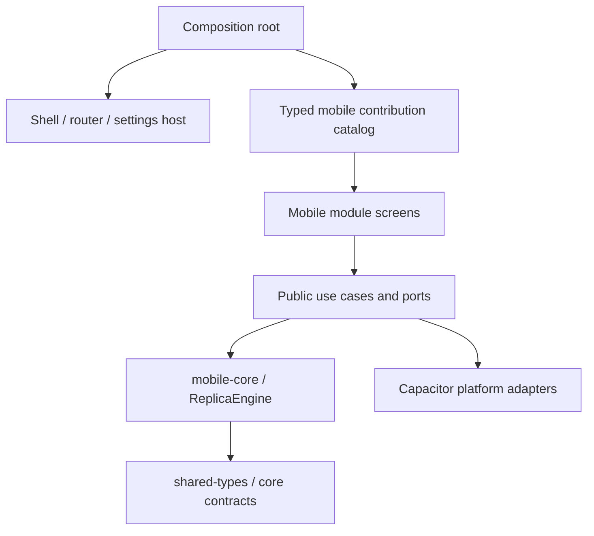

# Android frontend: архитектура роста

Статус: **PARTIALLY IMPLEMENTED**, alpha.13, 21.10.2026. Направление:
[PLATFORM](../PLATFORM.md), Stage 0; владение задаёт [карта миграции](../AI_REFACTOR_MIGRATION_MAP.md).
Ниже сохраняется целевой проект. Реальный срез: [RELEASE_ALPHA13](RELEASE_ALPHA13.md).
A1: composition root, repository/navigation controllers и Tasks/Notes вынесены;
LAN/finance/native adapters пока сохраняют существующие реализации. A2: device settings
catalog, partial patch и независимые ошибки полей. A3: typed hash routes со scope guard,
статический bundled registry; это не полный dynamic extension runtime. A4: семь реальных
settings pages, поиск/anchors, «Ещё», нижние иконки. A5: Lists на общих SyncOp.
A0 физическая OPPO-приёмка не завершена; A6 entity tables/media/restore — следующий
условный этап перед большими объёмами/файлами. G24 SDK не объявлен реализованным.

Читать вместе: [экраны модулей](MODULE_SURFACES.md), [настройки](SETTINGS_SPEC.md),
[предложение mobile contributions](EXTENSION_PROPOSAL_MOBILE_UI.md).

## 1. Продуктовая задача и границы

Пользователь: один человек или участник небольшой команды, телефон OPPO Reno8 5G.
Задача: быстро зафиксировать и обработать запись, найти нужный модуль, понимать,
где лежат данные и кого затрагивает действие. Результат: новый модуль подключается
без очередного ветвления в App и собственной навигации/настроек/синхронизации.
Последствия: меняется структура клиентского кода и позднее навигация; записи,
идентичности, очереди и публичные DTO при извлечении сохраняются.
Права: локальные операции не требуют входа; удалённые подчиняются серверным правам.
Признак успеха: tasks/notes/finance живут через один host contract; выключенный
модуль не ломает shell; добавление fourth fixture contribution не требует правки shell.
Полный перенос desktop, новый backend и загрузка произвольного JS не входят в этап.

Продуктовые решения ниже используют rule/preserve-mental-model,
rule/structure-before-containers, rule/name-object-scope-consequence,
rule/cover-reachable-states, rule/preserve-user-input. Инженерные границы выводятся
из Constitution/PLATFORM; это не новые продуктовые rule IDs.

## 2. Что уже есть, чего ещё нет

| Проверенный источник | Факт | Следствие |
|---|---|---|
| apps/android/src/main.tsx | App владеет tab/editor/history, загрузкой repository, формами, действиями, scope и частью JSX | Сейчас это composition root и контроллер сразу; новые domain ветки туда не добавлять |
| src/settings.tsx | Одна длинная страница appearance/update/export | Нет каталога страниц и параметров, поиска по настройкам и scope-aware bindings |
| src/task-list.tsx, finance.tsx | Отдельные UI-компоненты, локальный reorder и finance draft | Уже работающие сценарии сохранять при переносе |
| packages/mobile-core/src/index.ts | Atomic JSON snapshot в SQLite через native port; browser IndexedDB; serialized transactions | Не вводить второй canonical store в UI |
| remote-client.ts / mobile-replica.ts | ReplicaEngine, отдельный scope по node/fingerprint/user/workspace, queued operations | Не смешивать phone и remote outbox |
| hybrid-sync.ts | Протокол v1: list/listItem/note/task | Наличие domain DTO не даёт offline sync остальным модулям |
| MobileRemoteClient.hasModule | Проверяет included task/note | Это не полноценный клиентский каталог прав и возможностей |
| mobile-finance.ts | Локальные RUB операции, категории, счета, черновик | Finance remote sync отсутствует |
| src/storage.ts | Local snapshot до 8 MiB, remote envelope до 16 MiB в remote-client | Планировать миграцию до добавления больших файлов/многих модулей |
| packages/shared-types/src/modules.ts | 15 встроенных domain IDs + generated chat-archive/pet-care | Переиспользовать IDs; dashboard/settings/sync — shell, не новые domain modules |
| apps/web/lib/settings-catalog.ts, extensions/places.ts | Desktop scope-каталог и typed settings places | Перенять семантику; не импортировать web internals в APK |
| @orion/ui/theme | Public framework-safe theme entry | Общий язык KAIDEN уже есть; новый набор палитр не нужен |

Alpha.12 добавляет явные task/note actions и delete по существующему протоколу.
Это базовый CRUD, не обещание всех desktop fields, корзины и полного SDK.

## 3. Целевая структура: оболочка и клиентские адаптеры

```text
apps/android/src/
  main.tsx                       # mount + composition, без domain JSX
  app/
    bootstrap.tsx                # создание сервисов, built-in registrations
    shell/                       # header, navigation, error boundaries
    navigation/                  # typed routes, history, Back, restore
    runtime/                     # capability resolver, contribution composition
    settings/                    # каталог, поиск, pages и bindings
  platform/
    storage/ lan/ updates/ speech/ motion/ files/
                                  # Capacitor adapters + browser fallbacks
  features/
    tasks/ notes/ finance/         # screens, application controller, contribution
    # позже: calendar/, projects/... только после готового контракта
  shared/
    ui/                          # мобильные Page/Form/Entry/Settings primitives
    presentation/                # tokens bridge, typography, motion/elevation
    lib/                         # только domain-neutral helpers
```

`features/tasks` — мобильное представление существующего domain module, не новая
классификация Base/Plugin. Ownership остаётся по нормативной карте.
App bootstrap может знать конкретные встроенные contributions; reusable shell,
runtime и base feature не импортируют конкретные плагины.



Нельзя: feature → чужой feature/internal; SDK → app; mobile → web/panels;
mobile-core → React/Capacitor; settings host → private finance repository.
Mobile SDK и typed slots пока **не существуют** в нужном виде: сначала proposal,
потом узкий public contract, без фиктивного импорта @orion/plugin-sdk — планируется (G24).

## 4. Состояние и команды

| Состояние | Владелец | Ключ и время жизни |
|---|---|---|
| Domain entities/outbox/CAS/HLC | Repository или ReplicaEngine | Полный scope; durable |
| Черновик | Domain draft service через public port | scope + module + entity/new; durable |
| Route, фильтр, scroll | Navigation/view state | scope + module + view; восстановление после Back |
| Настройка | Settings binding конкретного scope | field ID + version; durable после commit |
| Loading/error конкретной команды | Feature controller | operation ID + scope; transient |
| Tilt/press/drag samples | Presentation adapter | transient, без root rerender и без хранения |

Поток: событие UI → проверка capability/scope → command → durable commit →
новый snapshot/view state → UI. «Сохранено на телефоне» и «Отправлено на ПК» —
разные состояния. Failed durable write не выдаёт success и не стирает форму.
Для repo нужен narrow subscription/commit adapter (сейчас есть snapshot(), но нет
универсального subscribe). ReplicaEngine.subscribe уже существует. Не дублировать
entities в новом global store/Query cache. Новый state manager не нужен для начала.
React useSyncExternalStore подходит для view adapter после появления port.

Вместо общего busy на всё приложение — busy конкретной команды. Переключатель
темы не блокирует заметки; финансовая запись не запускается повторно двойным tap.
Поздний ответ от старого scope не публикуется в новом: scope/generation guard,
unsubscribe на смене пространства, отмена запроса где поддержана.

## 5. Контекст, возможности, offline

Scope — discriminated union phone/remote; remote содержит nodeId, fingerprint,
userId, workspaceId, а не только workspaceId. Новая ссылка не является правом.
Во всех экранных заголовках виден текущий scope. Проект — необязательный фильтр,
не второй владелец данных и не обязательное поле каждой записи.

Доступность вычисляется из нескольких независимых фактов: есть mobile renderer,
модуль включён workspace policy, роль разрешает действие, capability поддержана,
данные закешированы, операция может исполняться offline. Не один enabled boolean.
Сервер остаётся авторитетом; last-known permission не гарантирует разрешение
offline операции. Revoked/auth expired обрабатываются отдельными состояниями.

У каждого use case режим: local, replica-write, cached-read либо online-only.
Finance сейчас local. У остальных модулей режим не назначается по наличию REST
endpoint: сначала adapter, хранение, конфликтная семантика и тест.
Если выбран remote scope без finance, показывать ограничение и явное «Открыть
финансы на телефоне», а не подменять workspace молча. Черновик старого scope сохранять.

## 6. Навигация

Целевой shell: контекст пространства сверху; внизу до четырёх закреплённых
доступных направлений и «Ещё». Defaults alpha.13: Задачи/Заметки/Финансы/Списки/Ещё; иконки обязательны.
«Ещё» содержит каталог модулей, настройки и подключение; настройки также доступны
через явную шестерёнку header. Не занимать постоянную вкладку каждым новым модулем.
Позже полезный «Обзор» — shell aggregate через contributions; до появления реальных
виджетов не ставить пустой dashboard по умолчанию. Закрепление персонально, не
меняет enabled policy команды. При 0 domain modules shell/settings/data остаются доступны.
Rule/navigation-vs-action, rule/structure-before-containers, rule/smallest-intervention.

Typed routes включают scope, owner module, screen, entity ID; пример
`#/scope/phone/module/lists?entity=<uuid>` и `#/settings/appearance?field=theme`. Секретов в URL нет.
Начать с typed adapter над history/hash, уже пригодным для Capacitor; замену router
library оценивать отдельно. Route definitions и search anchors стабильны.
Back: закрыть действие/подтверждение → editor с сохранённым draft → list с фильтром
и scroll → предыдущий destination → стандартное системное поведение на root.
Native Back и browser Back идут через один route adapter; predictive OS animation
не считается реализованной наличием popstate.
Compact: один экран; tablet/wide: list-detail + rail при достаточном месте.
Ориентироваться на доступную ширину, safe areas и keyboard, не имя телефона.

## 7. Общие UI-контракты

PageHeader: scope, title, одно главное действие, меню вторичных. ModulePage: query,
фильтры, data state, content, permission/error recovery. EntryCard: main action,
статус, меню Изменить/Архив/Удалить по реальным capabilities, accessible labels.
FormPage: поля, validation, durable draft, SaveState, safe leave. SettingsPage:
scope line, sections, field anchors, per-field save errors. StateView различает
empty/filter-empty/offline-stale/forbidden/unavailable/error. rule/one-primary-action,
rule/cover-reachable-states, rule/keyboard-complete-flow, rule/accessible-name-required.

KAIDEN tokens общие с desktop; мобильные плотность/48px targets/safe areas свои.
Одна elevation scale: base chrome → whole content card → foreground overlay.
После исправления параллакса 27.10.2026 текст и карточки используют общий
сдвиг с небольшой разницей глубины, без отдельных камер, произвольных Z и
встречных rotations. См. MOTION_COMPACT_UI_2026-10-27.md. Жесты — ускорители видимых кнопок. Нет критического действия,
доступного только через long press/drag/voice. OS reduced motion имеет приоритет.
Не запрашивать permissions при старте без сценария (rule/value-before-interruption).

## 8. Хранение и изменения схем

На первом этапе извлечения оставить существующие JSON/SQLite, aliases и draft keys.
Не совмещать переезд файлов с миграцией хранилища. Перед крупными domain/file
модулями проектировать entity tables/indexes/outbox/media отдельной миграцией:
backup → staging → integrity checks → atomic switch → recovery path.
Файлы отдельно, не base64 в snapshot; backup с media требует нового формата.
Portable backup v1 сейчас экспортирует content, не полную установку со settings,
секретами и device identity. Restore UI отсутствует; обещать восстановление нельзя.
Новый device получает новую identity; старые deviceSeq/outbox не проигрываются как новые.

## 9. Порядок исполнения и выходные условия

| Шаг | Результат | Приёмка |
|---|---|---|
| A0 | Базовый CRUD и input/tilt стабильны | edit/delete/restart/failure/tilted tap tests; OPPO отдельно |
| A1 | Вынести bootstrap/controllers/ports без нового UI | все нынешние smoke, snapshots и routes сохранены |
| A2 | Каталог settings + partial patch binding | 2 быстрые записи не перетирают друг друга; deep link/search/Back |
| A3 | Typed routes и module registry | fixture fourth module без shell changes; disabled не теряет данные |
| A4 | Новый settings hub и «Ещё» отдельным UX-срезом | никакого исчезнувшего действия; 320px/200%/TalkBack/Back |
| A5 | Один новый domain adapter | module-specific offline/permissions/conflicts, не blanket sync |
| A6 | Масштабирование data/media | migration/backup/restore fault injection до больших объёмов |

У каждого шага отдельный commit/PR concern и reversible path. Не использовать
plan как разрешение массово менять desktop. Unit + boundary checks + browser
и native build обязательны для кода; OPPO/две установки/реальный LAN отмечать отдельно.
Физические эффекты пока не приняты, desktop CI billing ограничения не маскировать.

Основания подхода: [Android UI layer](https://developer.android.com/topic/architecture/ui-layer)
(state holders и однонаправленные события), [adaptive navigation](https://developer.android.com/develop/ui/compose/layouts/adaptive/build-adaptive-navigation)
(bar/rail по ширине). Это принципы, не переход данного React/Capacitor приложения на Compose.

